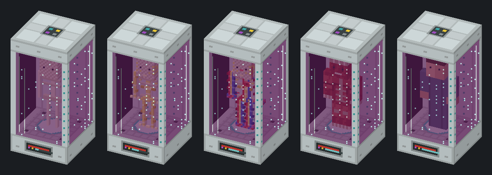

# Matter Rebirth

> ### *Not today.*
> Even on Hardcore, death is not the end: you get a second chance. Or more than one.

Unofficial addon for **IndustrialCraft 2 Experimental** (Minecraft 1.12.2, Forge).

Grow inactive clones of yourself from liquid UU-Matter. If you die while wearing a Neurosynchronizer
(or an IC2 Quantum Helmet), your mind wakes up in the nearest ready clone instead of the death screen.
On Hardcore this turns death into a rebirth; in normal survival it is an expensive but reliable insurance.

> **Work in progress.** The mod is not released yet. Pictures below are concept art; numbers may change.

[Русская версия](README.ru.md)

## How it works

1. **Vacuum Syringe.** Right-click to draw your own blood and get a Blood Sample tagged with your name.
2. **IC2 Scanner.** Scanning the sample turns it into a genetic pattern that keeps its owner.
3. **IC2 Pattern Storage** keeps the pattern; a Crystal Memory moves it between storages as usual.
4. **Clone Replicator.** Two identical construction blocks stacked on top of each other assemble into the machine.
   It reads the pattern from the adjacent storage and grows a clone from liquid UU-Matter and EU
   in five stages: skeleton, nerves, blood vessels, muscles and skin.
5. **Neurosynchronizer** or IC2 Quantum Helmet on your head. Without one, the mind is not transferred.

A clone costs one bucket of UU-Matter and takes one in-game day to grow (512 EU/t, HV machine).
A ready clone needs a little UU and 16 EU/t to stay alive. With an **Interdimensional Anchor** upgrade
a clone can catch your mind from other dimensions too.

## Requirements

- Minecraft 1.12.2, Forge 14.23.5.2847+
- IndustrialCraft 2 2.8.222-ex112 or newer

Optional: JEI / HEI (info pages), CoFH Core (Soulbound items stay with you).

## License

MIT
