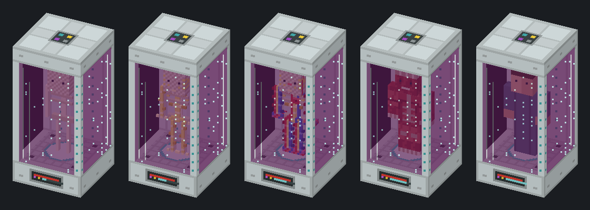
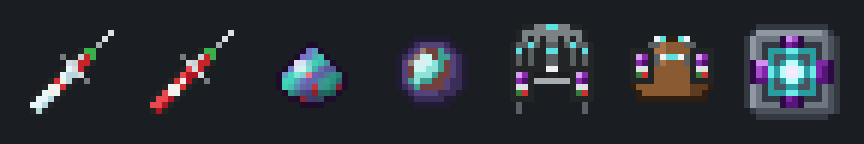

# Matter Rebirth

Неофициальный аддон к **IndustrialCraft 2 Experimental** (Minecraft 1.12.2, Forge).

Выращивайте неактивные клоны самого себя из жидкой UU-материи. Если умереть в нейросинхронизаторе
(или в квантовом шлеме IC2), то вместо экрана смерти сознание проснётся в ближайшем готовом клоне.
В Хардкоре смерть превращается в воскрешение, а в обычном выживании это дорогая, но надёжная страховка.

> **В разработке.** Мод ещё не выпущен. Картинки ниже — концепт, числа могут измениться.

[English version](README.md)

## Как это работает

1. **Вакуумный шприц.** ПКМ берёт кровь у себя, получается образец крови с вашим именем.
2. **Сканер IC2.** Сканирование превращает образец в генетический шаблон, который помнит владельца.
3. **Хранилище шаблонов IC2** хранит шаблон, кристалл памяти переносит его между хранилищами, как обычно.
4. **Репликатор клонов.** Два одинаковых конструкционных блока, поставленные друг на друга, сами собираются в машину.
   Она берёт шаблон из соседнего хранилища и выращивает клон из жидкой UU-материи и EU
   за пять стадий: опорная, нервная и венозная системы, мышцы и кожа.
5. **Нейросинхронизатор** или квантовый шлем IC2 на голове. Без них перенос сознания не происходит.

Клон стоит одно ведро UU-материи и растёт один игровой день (512 EU/т, машина HV).
Готовому клону для жизни нужно немного UU и 16 EU/т. С улучшением **«Межпространственный якорь»**
клон принимает сознание и из других измерений.

## Требования

- Minecraft 1.12.2, Forge 14.23.5.2847+
- IndustrialCraft 2 2.8.222-ex112 или новее

Необязательно: JEI / HEI (информационные страницы), CoFH Core (предметы с «Печатью души» остаются у вас).

## Лицензия

MIT
